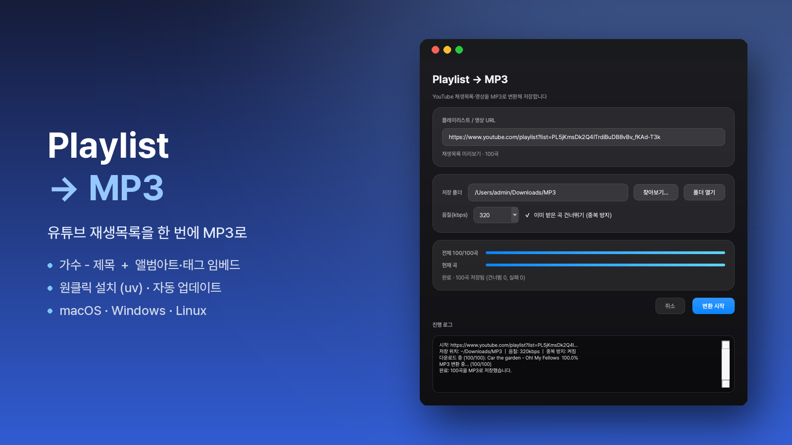

# Playlist → MP3



YouTube 플레이리스트(또는 단일 영상) URL을 넣으면 각 항목을 **`가수 - 제목.mp3`** 로
변환해 저장하는 크로스 플랫폼(macOS · Windows · Linux) GUI 앱. 태그(아티스트/제목/앨범)와
앨범아트(원본 비율)를 파일에 임베드합니다.

## 설치 (원클릭)

터미널에 아래 한 줄을 붙여넣으면 `uv` 설치 → 앱 설치까지 끝납니다.

**macOS / Linux**
```sh
curl -LsSf https://raw.githubusercontent.com/Yeonji-Gonji/playlist-to-mp3/main/install.sh | sh
```

**Windows (PowerShell)**
```powershell
irm https://raw.githubusercontent.com/Yeonji-Gonji/playlist-to-mp3/main/install.ps1 | iex
```

설치 후 새 터미널에서 실행:
```
playlist-to-mp3
```

### 수동 설치 (uv가 이미 있는 경우)
```sh
uv tool install git+https://github.com/Yeonji-Gonji/playlist-to-mp3
```
업데이트: `uv tool upgrade playlist-to-mp3`

## 사용법
1. `playlist-to-mp3` 실행 → 창이 뜹니다
2. 플레이리스트/영상 URL 붙여넣기
3. 저장 폴더 선택, 음질(128/192/320kbps) 선택
4. **변환 시작**

- **중복 방지**: 저장 폴더의 `.download_archive.txt`에 받은 항목을 기록해, 다시 돌려도 새 곡만 받습니다.

## ffmpeg 처리
- **시스템 PATH에 ffmpeg/ffprobe가 있으면** 그걸 사용합니다.
- **없을 때**:
  - Windows / Linux → 첫 실행 시 정적 빌드를 자동 다운로드해 캐시에 설치
  - macOS → `brew install ffmpeg` 로 설치 (원클릭 스크립트가 자동 시도)

## 기술 메모
- GUI: PySide6(Qt) — 크로스 플랫폼.
- YouTube SABR 강제 회피를 위해 `android_vr` player client 사용 (PO 토큰 불필요).
- 다운로드 작업은 별도 스레드에서 실행, 진행률/로그를 Qt 시그널로 UI에 전달.
- 출력 템플릿: `%(artist,creator,uploader)s - %(title)s`, postprocessor로 메타데이터 +
  썸네일(jpg 변환 후) 임베드, 플레이리스트 자체 썸네일은 저장 안 함(`pl_thumbnail`).

## (선택) macOS .app 로 빌드하기
uv 배포 대신 더블클릭 아이콘이 필요하면 PyInstaller로 번들할 수 있습니다(Apple Silicon 전용,
미서명이라 첫 실행 시 우클릭 → 열기 필요):
```bash
uv run --with pyinstaller pyinstaller --noconfirm "Playlist to MP3.spec"
```
결과물: `dist/Playlist to MP3.app`

빌드 전에 macOS용 `ffmpeg`·`ffprobe` 실행 파일을 `vendor/` 에 둡니다. spec 이 이 둘을 번들에 넣고(git 에는 올리지 않음),
번들 앱은 시스템 PATH 보다 번들 안의 ffmpeg 를 먼저 씁니다. 유료 서명(Apple Developer)은 하지 않으며 기본 배포는 위의 uv 경로입니다.

## 개발·릴리스
이 앱은 main 브랜치가 곧 설치 소스입니다. `uv tool install git+…`·`install.sh`·`install.ps1`·`uv tool upgrade` 가 모두
main 최신을 받으므로, main 에 깨진 커밋이 올라가면 모든 사용자의 다음 업그레이드가 깨집니다. main 은 PR 과
CI(`.github/workflows/ci.yml`: 휠 빌드 → 폰트 포함 확인 → 새 가상환경 설치 → 헤드리스 import) 통과로만 바뀝니다.

- **변경 후 최소 확인**: CI 는 GUI 동작을 보지 않으므로 `uv run playlist-to-mp3` 로 창이 뜨는지, 짧은 공개 영상
  1개를 변환해 태그·앨범아트가 박히는지 직접 봅니다.
- **버전 올리기**: `pyproject.toml` 의 `version` 과 `playlist_to_mp3/__init__.py` 의 `__version__` 을 함께 올리고,
  머지 후 그 커밋에 `v<버전>` 태그를 답니다. 설치 기준은 main 이고 태그는 기록용입니다.

| 경로 | 역할 |
| --- | --- |
| `playlist_to_mp3/app.py` | Qt 창(다크·라이트, frameless glass UI). URL 입력 → yt-dlp 다운로드 → mutagen 태그 임베드 |
| `playlist_to_mp3/ffmpeg_setup.py` | ffmpeg·ffprobe 위치 해석(우선순위는 파일 머리 주석) |
| `playlist_to_mp3/fonts/` | UI 폰트. 패키지 폴더 안이라 휠에 자동 포함됨(`pyproject.toml` 주석) |
| `pyproject.toml`, `install.sh`, `install.ps1`, `Playlist to MP3.spec` | uv 설치, 선택적 PyInstaller 번들 |
| `icon.iconset/`, `icon.icns`, `icon_1024.png`, `make_icon.py` | macOS 아이콘 생성 |
